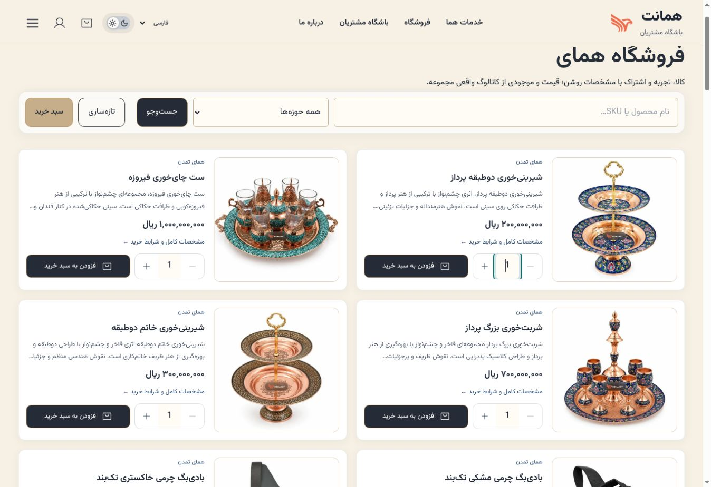
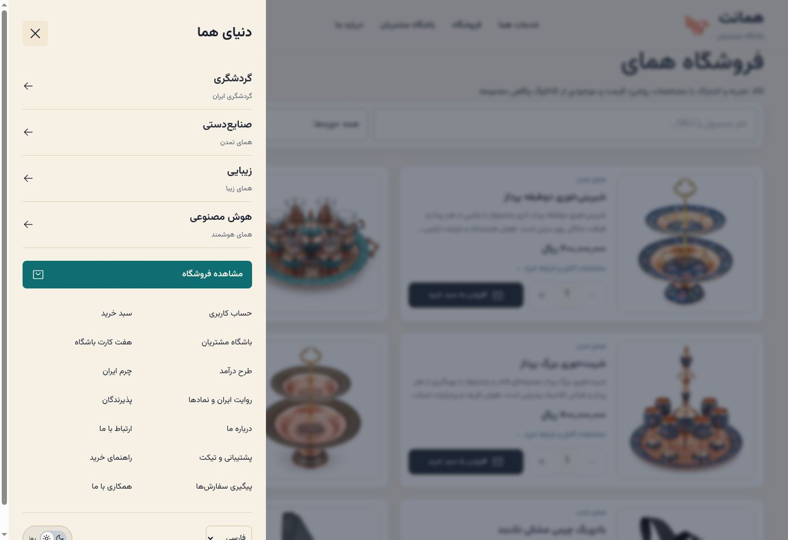
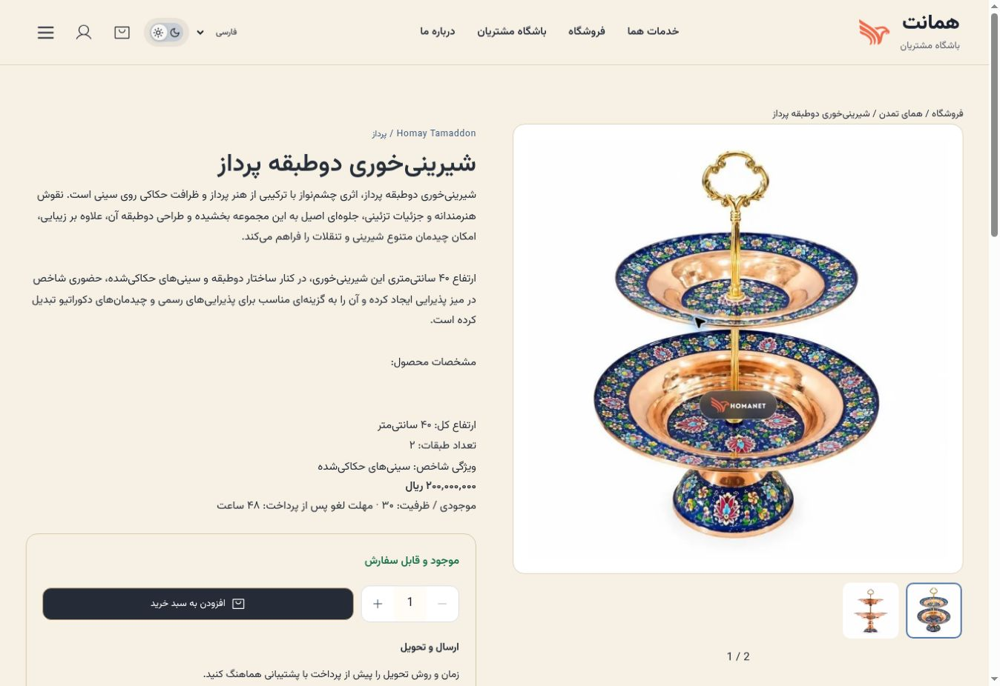
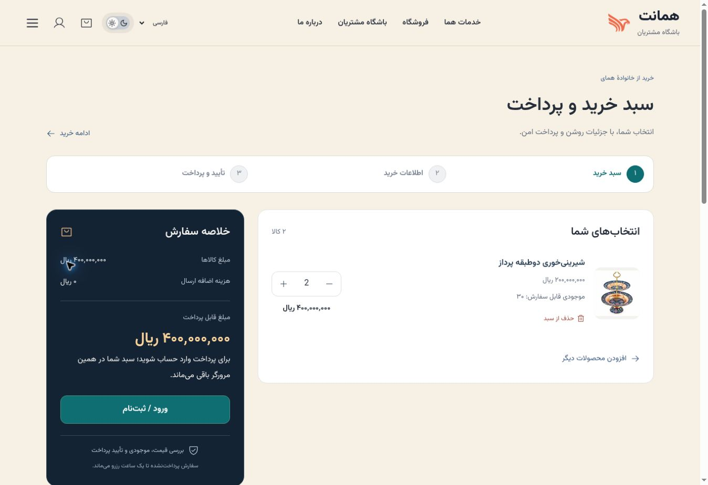

# Homay purchase controls review — 13 October 2026

## Scope and limits

Current production source approval: `31bd7e639b30ef79e6d795dc17cd8441e7dfcb32`; installed server merge: `2eeccf16c6bdacd92c1704e631f504d065c281ce`. Fresh Homa status returned HTTP 200/probe exit 0 and both services active/running. This review used the cloud browser's desktop viewport and source inspection. It is not a completed phone/device audit or Core Web Vitals measurement.

The browser exposes no viewport emulation capability. Opening a local responsive snapshot was rejected by browser URL policy; no alternate method was used to bypass that restriction. Widths 360/390/430, mobile keyboard occlusion, zoom, slow-network LCP, signed-in checkout and live payment remain unverified here.

## Captured steps

1. **Shop — defect reproduced.** Clearing the quantity input immediately restored `1`, making replacement with a keyboard awkward. Live measured public quantity buttons were 44×44 pixels and the field font was 16 pixels. These dimensions are desktop measurements, not phone assertions.

   

2. **Navigation menu — passed the checked behavior.** The menu opened, its close control received focus, and closing restored focus to the opener and body scrolling. The desktop screenshot shows the public menu; narrow-screen layout still needs device verification.

   

3. **Product — passed the public navigation and basket action.** Following the product link showed title, price in rials, stock, cancellation notice, gallery and purchase control. Adding one item produced a confirmation and cart link. No order or payment was submitted.

   

4. **Cart — passed the public quote display; authentication blocked later stages.** The basket quote showed item quantity, line total, no extra shipping charge and a sign-in prompt. The browser already had one item; adding one made two. After capturing the cart, decrementing returned it to the original quantity of one. Checkout, payment and order tracking were not exercised in this run.

   

## Corrections

- The shared QuantitySelector keeps an editable draft. Empty, fractional or out-of-stock drafts do not change the saved quantity. Leaving the field restores the last valid saved quantity. Buttons and caller quantity/stock changes resynchronize the draft.
- Added numeric input mode and an explicit integer step. Native number validation remains in place.
- Applied the existing public 44-pixel button size and 16-pixel quantity field font to the account panel too. This is a source change, not a verified phone rendering result.
- Added the three meaningful quantity regression tests to the deployment gate.

## Validation

Twenty-one focused tests passed across quantity editing, purchase flow, client resilience, localization and shared navigation. Fresh TypeScript and production build passed. Eight deployment script checks and shell syntax passed. No mobile image speed, full accessibility certification or production payment claim is made. The complete previous release suite had 469 passing tests; it was not rerun for this focused change.
